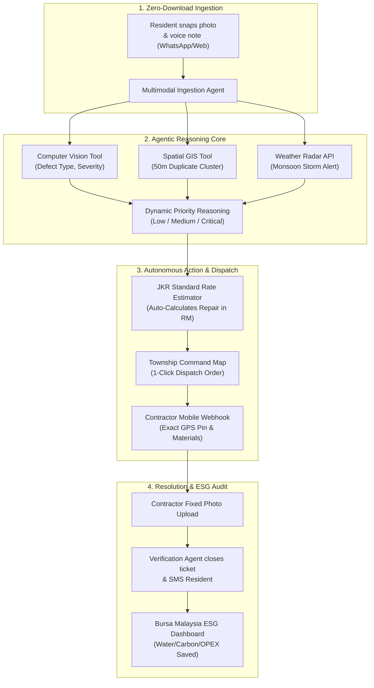

# 🏙️ TownshipPulse: Reusable Master Skill & System Context

> **HOW TO USE THIS FILE:**  
> Paste the contents of this markdown file into **ANY LLM** (ChatGPT, Claude, Gemini, DeepSeek, or a local model), or place it into your project's `.agents/skills/townshippulse/SKILL.md` directory. The AI will immediately have 100% full context of the project, architecture, code requirements, and business strategy without needing any explanation.

---

## 📌 Executive Summary & Hackathon Context

* **Project Name:** **TownshipPulse** (Autonomous Infrastructure & Operations Copilot)
* **Competition:** **Sime Darby Property University Hackathon 2026**
* **Theme:** *"Township of Tomorrow"* (People + Planet Tracks)
* **Organizers:** Sime Darby Property Berhad × Kolaxus Innovation Platform
* **Target Pilot Township:** **City of Elmina** (5,000 acres, Shah Alam, Selangor) / **Bandar Bukit Raja** (Klang, Selangor)
* **Team Profile:**
  * **Lead Developer:** Ghulam Mustafa (AI Systems & Backend Architect)
  * **Core Stack:** Python, Google Gemini 1.5 Flash (Multimodal), OpenStreetMap/Leaflet, Open-Meteo APIs, Streamlit / Next.js, PostgreSQL.
* **Core Value Proposition:** Replaces slow, manual, text-only resident complaint forms with a **zero-download, multimodal agentic copilot** that groups duplicate reports, correlates weather and spatial anomalies, auto-estimates repair costs, and drafts contractor dispatch orders in under 5 seconds.

---

## 💥 The Real-World Problem We Solve

In massive master-planned Malaysian townships (e.g., City of Elmina with 30,000+ residents across Elmina Valley, Elmina Green, and Elmina Ridge):

1. **App Fatigue / High Friction:** Residents refuse to download a 100MB standalone app just to report a clogged drain once a year. They vent on Facebook or WhatsApp groups, bypassing township staff.
2. **Ticket Flooding & Duplicate Chaos:** When a water pipe bursts or a storm drain floods, 50 to 100 residents submit identical complaints. Office staff waste hours reading and logging duplicate tickets.
3. **Slow "Blind Dispatch":** Management receives vague text (*"Streetlight dark near park"*). Staff must manually drive out to inspect, write paperwork, find contractor quotes, and take 7–14 days to fix a simple issue.
4. **Catastrophic Infrastructure Escalation:** Unmonitored leaks or drainage clogs during Malaysian monsoon downpours quickly escalate into road collapses, sinkholes, and flash floods costing RM 50,000+ per incident.

---

## 🤖 The "Top 1%" Agentic Architecture (NOT an LLM Wrapper)

TownshipPulse is **not a chatbot**. It is an **Autonomous Operational Agent** that utilizes tools, computer vision, geospatial clustering, and external APIs to complete an end-to-end operational workflow:



### The 4 Autonomous Agent Tools:
1. **Tool 1: `inspect_defect_vision()`**  
   Analyzes uploaded photo with Gemini 1.5 Flash. Identifies object class (pothole, blocked drain, broken streetlight, fallen branch, pipe leak), estimates severity score (1–10), and verifies photo authenticity (rejects indoor/fake memes).
2. **Tool 2: `spatial_cluster_detector()`**  
   Queries PostgreSQL with PostGIS. Checks if an active incident exists within a **50-meter radius**. If found, groups the new ticket as a duplicate child report, increments the community urgency counter, and prevents spamming contractors.
3. **Tool 3: `weather_context_evaluator()`**  
   Queries Open-Meteo / METMalaysia API for local hourly precipitation. If heavy rainfall (>30mm/h) is forecasted within 3 hours, a blocked drain is automatically escalated from **Low** to **CRITICAL EMERGENCY**.
4. **Tool 4: `contractor_work_order_generator()`**  
   References standard Malaysian Public Works (JKR) Schedule of Rates. Pulls required materials, estimated labor hours, and generates a formatted repair order with estimated cost in Ringgit (e.g. *RM 450*).

---

## 💰 Complete Financial & Operating Cost Model

Judges require proof of commercial viability and cost-effectiveness:

### Monthly Operating Cost (for a 5,000-Home Township generating ~1,000 tickets/mo):
* **AI Inference (Google Gemini 1.5 Flash):** **~RM 5.00 – RM 10.00 / month**  
  * *Pricing:* $0.075 / 1M input tokens, $0.30 / 1M output tokens, ~$0.00002/image.
  * *Per-Ticket Cost:* Less than **0.5 Malaysian Sen (RM 0.005)**.
* **Geospatial & Mapping (OpenStreetMap / Leaflet):** **RM 0.00** (Open Source).
* **Weather Radar (Open-Meteo / METMalaysia data.gov.my):** **RM 0.00** (Open Government Data).
* **Database & Hosting (Google Cloud Run + Postgres):** **~RM 50.00 – RM 80.00 / month**.
* **Messaging (WhatsApp Cloud API):** **RM 0.00 – RM 20.00 / month** (Meta provides 1,000 free service conversations per month).
* **TOTAL PLATFORM RUNNING COST:** **~RM 75.00 to RM 120.00 / month ($16 – $25 USD)**.

### Model Alternatives & Vendor Independence:
TownshipPulse features a model-agnostic gateway:
* **Primary:** Google Gemini 1.5 Flash (Lowest cost, highest speed).
* **Enterprise Fallback:** OpenAI GPT-4o-mini ($0.15/$0.60 per 1M tokens, ~RM 10/month total).
* **Private / On-Premise Sovereign:** Meta Llama 3.2 Vision (11B) or Qwen2-VL (7B) self-hosted on local hardware (e.g. EMARQUE AI workstation in Malaysia) for 100% data residency compliance.

### Return on Investment (ROI):
* **Township Office Labor Savings:** Cuts manual ticket dispatching time by 75% (saving ~RM 4,000/month in staff overhead).
* **Preventative Damage Savings:** Stops drainage blockages before flash floods cause RM 50,000+ road and property repairs.
* **Payback Period:** Under **48 hours** each month.

---

## 📊 Database & Data Contract Schemas

```json
{
  "incident_ticket": {
    "ticket_id": "ELM-2026-1042",
    "township": "City of Elmina",
    "precinct": "Elmina Green 1",
    "coordinates": {"lat": 3.1945, "lng": 101.5123},
    "timestamp": "2026-10-20T09:14:00+08:00",
    "reported_via": "whatsapp_bot",
    "raw_input": {
      "image_url": "https://storage.townshippulse.my/incidents/drain_402.jpg",
      "text": "Longkang sumbat dekat simpang taman, air dah bertakung"
    },
    "agent_analysis": {
      "category": "DRAINAGE_AND_FLOOD_PREVENTION",
      "defect_type": "HEAVY_SILT_AND_DEBRIS_BLOCKAGE",
      "confidence": 0.96,
      "severity_score": 9,
      "priority": "CRITICAL",
      "contextual_factors": {
        "weather_alert": "HEAVY_RAIN_FORECAST_90_MINUTES",
        "duplicate_count_50m": 3,
        "is_primary_incident": true
      }
    },
    "work_order": {
      "contractor_id": "VENDOR_SELANGOR_DRAIN_04",
      "task_description": "Clear silt and plastic obstruction at culvert D-402",
      "estimated_materials": ["Jetting machine", "Waste disposal skip"],
      "estimated_cost_myr": 350.00,
      "status": "DISPATCHED",
      "dispatch_timestamp": "2026-10-20T09:14:04+08:00"
    }
  }
}
```

---

## 🎯 The 7-Slide Winning Proposal Deck (Word-for-Word)

### Slide 1: Cover Slide
* **Title:** **TownshipPulse**
* **Subtitle:** Autonomous Infrastructure & Operations Copilot for the Township of Tomorrow
* **Target Township:** Piloted for City of Elmina & Bandar Bukit Raja
* **Team:** [Your Team Name] — Sime Darby Property University Hackathon 2026

### Slide 2: The Expensive Problem
* **Headline:** 5,000-Acre Townships Cannot Be Managed with WhatsApp & Paper Tickets
* **Key Metrics:**
  * 7 to 14 days average resolution cycle for common infrastructure complaints.
  * 40% of customer service tickets in mature townships are duplicate complaints.
  * Unmonitored drainage and pipe failures turn into catastrophic RM 50,000+ flash flood damage.

### Slide 3: The Solution — TownshipPulse
* **Headline:** Frictionless Resident Ingestion Meets Autonomous Operational AI
* **How It Works:**
  * Zero App Download: Residents submit via WhatsApp or web in English/Malay.
  * Multimodal Reasoning: Computer vision classifies defects and extracts GPS.
  * Spatial Root-Cause Engine: Groups 50 duplicate reports into 1 root-cause alert.
  * Instant Dispatch: Auto-drafts contractor work-orders in under 5 seconds.

### Slide 4: System Architecture & Technical Moat
* **Headline:** True Agentic Workflow with Multimodal Reasoning & Tool Calling
* **Diagram:** Ingestion $\rightarrow$ Gemini 1.5 Flash Vision $\rightarrow$ PostGIS Spatial Clustering $\rightarrow$ Weather API $\rightarrow$ JKR Rate Estimator $\rightarrow$ JMB Command Dashboard.
* **Enterprise Integration:** Plugs as a headless API into Sime Darby’s existing SAP, Yardi, or resident portals without replacing legacy software.

### Slide 5: Measurable Economic & ESG Impact (The Money Slide)
* **Headline:** Over RM 5,000 Net Monthly Savings per Township Phase
* **Operational ROI:**
  * 70% reduction in customer service administrative triage time.
  * Elimination of false-alarm contractor inspection callout fees.
  * Automated compliance dashboard reporting directly to Bursa Malaysia ESG guidelines.

### Slide 6: Pilot Implementation Roadmap (City of Elmina)
* **Month 1–2:** Integration with City of Elmina precinct asset database (streetlights, culverts, parks).
* **Month 3–4:** Closed pilot across 1,000 homes in Elmina Valley with local JMB.
* **Month 5–6:** Full rollout to Bandar Bukit Raja and commercial logistics zones.

### Slide 7: Team & Execution Capability
* **Headline:** Full-Stack AI Builders with Deep Systems Expertise
* **Roles:** Technical AI Architect, UI/UX Frontend Lead, Business & Operations Strategist.
* **Closing Hook:** *"Transforming township blueprints into responsive, self-healing communities."*

---

## 🛡️ Judge Q&A Defense Playbook (How to Answer Tough Questions)

#### Q1: *"Isn't this just Zendesk or Jira with ChatGPT?"*
> **Answer:** *"No. Zendesk is a passive, text-only ticketing queue where humans do 100% of the thinking and dispatching. TownshipPulse is an **autonomous spatial agent**. It looks at photos with computer vision, correlates weather radar forecasts, recognizes when 5 reports are actually one blown transformer, and drafts an instant contractor work-order with standard JKR costs. It replaces manual triage with autonomous action."*

#### Q2: *"What if residents upload fake photos or memes?"*
> **Answer:** *"Our vision agent validates image authenticity. It checks if the photo contains real physical infrastructure defects, extracts camera EXIF metadata, and cross-references GPS boundaries within the Sime Darby masterplan. Non-infrastructure uploads are filtered out instantly with zero human time wasted."*

#### Q3: *"How will you get residents to use this?"*
> **Answer:** *"By eliminating app downloads completely. Residents use their existing WhatsApp or a 2-second mobile web link. If you require residents to download a 100MB app, 90% won't use it. By meeting residents on WhatsApp, adoption is immediate."*

#### Q4: *"Can this integrate with Sime Darby's existing SAP or facility management software?"*
> **Answer:** *"Yes. TownshipPulse was designed as a headless API microservice. It does not replace SAP or Yardi; it acts as an intelligent frontend that feeds verified, structured JSON payloads directly into their existing enterprise databases via webhooks."*

---
*Created for Ghulam Mustafa | Sime Darby Property University Hackathon 2026*
